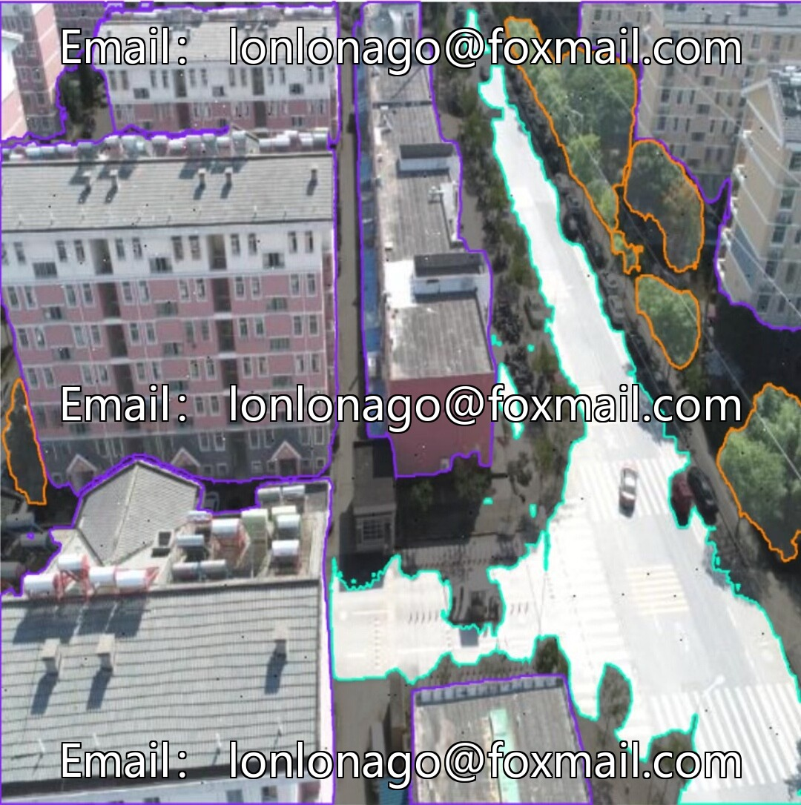
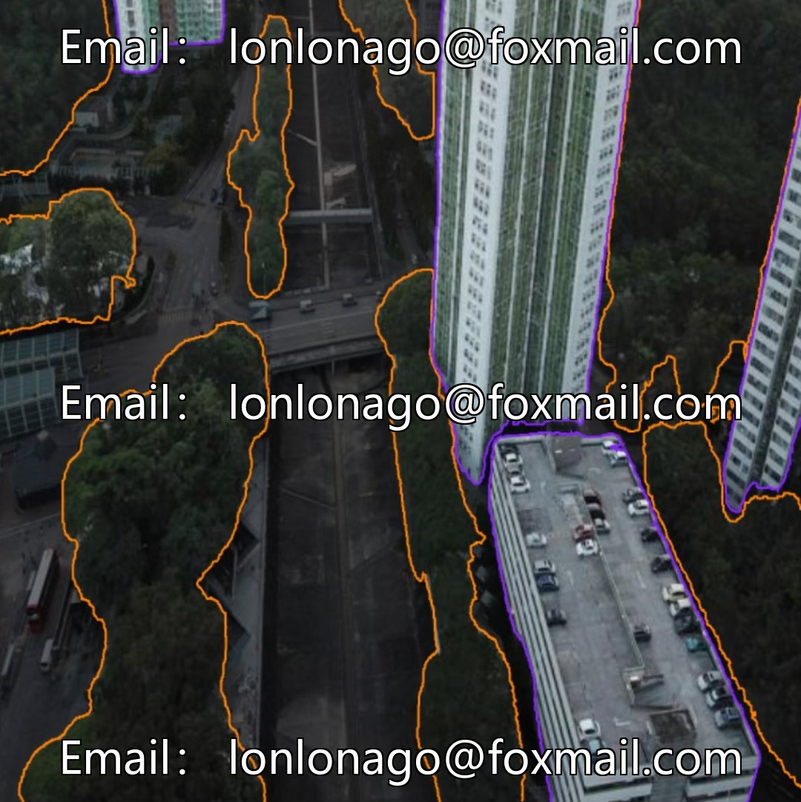
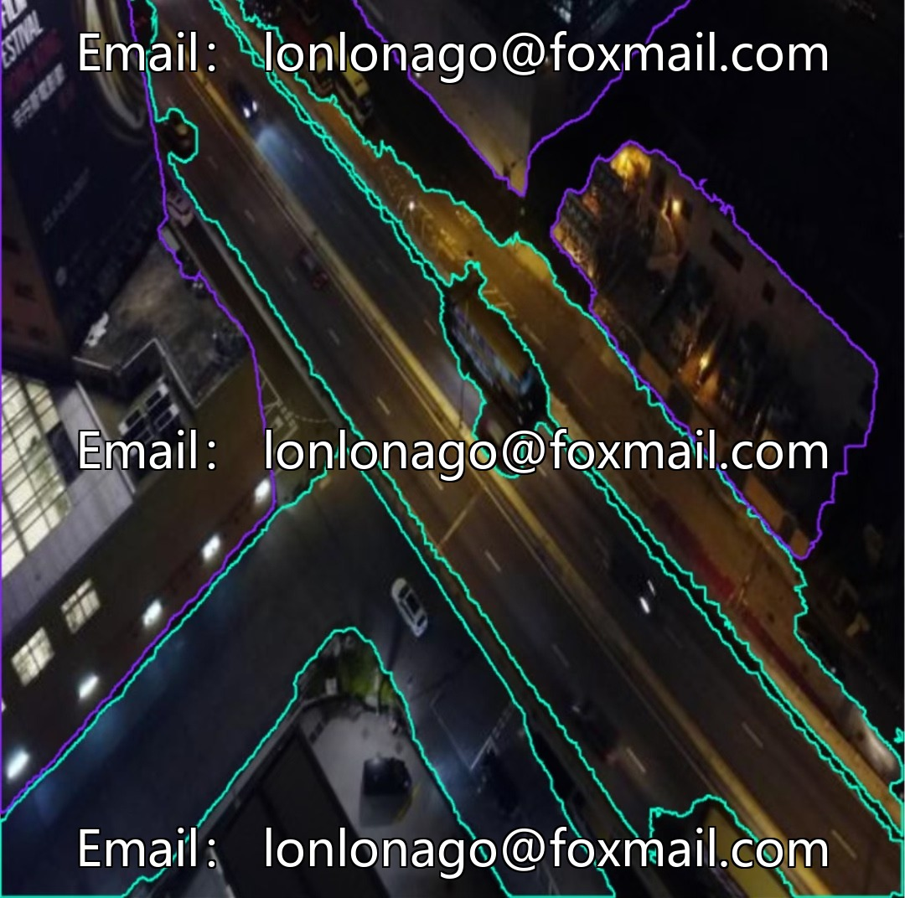
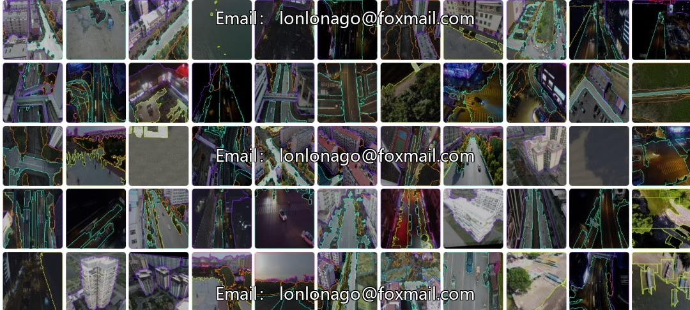

# Drone scene instance segmentation dataset

## Body

Drone scene instance segmentation dataset for drone visual inspection, specifically designed for urban roads and areas, buildings, sky, trees, rivers, etc., 10457th issue

The dataset has high accuracy in annotation, comprehensive coverage of scenarios, supports mainstream deep learning frameworks, no need for format conversion, directly connects to model training, tuning, and validation.

The dataset consists of 7 categories of Chinese targets: buildings, grass, ground, road, sky, trees, water. The category division is in line with the actual needs of UAV aerial photography, with clear boundaries and no cross-redundancy. The samples are evenly distributed, suitable for training instance segmentation models such as RFDETR, enhancing the algorithmic capabilities for drone visual inspections and scene analysis.

Data volume: 4666 labeled samples, supports YOLO format. Fully equipped with training, validation, and test sets, suitable for the full process of model development in medium to small-scale models.

Virtual materials, once sold, are non-refundable.
Interested friends, click "I want" to proceed.

## Images

## Payment

Here is a pay link on Stripe ( https://buy.stripe.com/3cs8yP7sY87d0vu9AB ). Please contact me lonlonago@foxmail.com after funding $89, and I will send you a complete data files , thank you!

